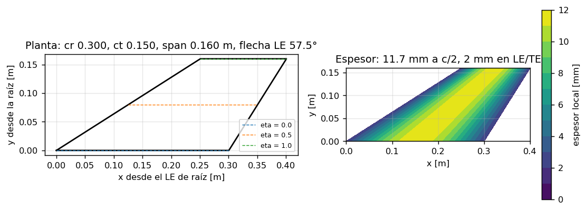
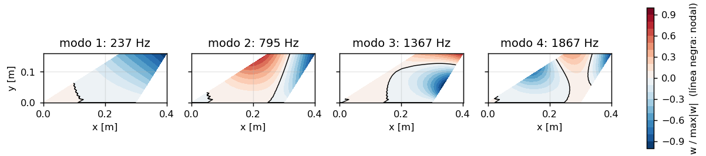
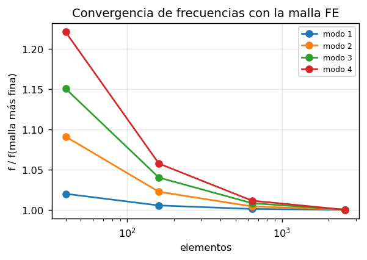

# Flutter de aleta del Aconcagua — procedimiento completo

Este documento explica cómo se calcula, de punta a punta, si la aleta de CFRP del
Aconcagua puede entrar en flutter durante el vuelo: desde la geometría de
`flightModel` hasta el análisis no lineal (LCO). Está escrito para alguien que nunca
abrió la repo, con nociones básicas de FEA y de CFD.

Además es el **registro de trabajo**: cada paso dice qué hace, cómo se corre, qué
archivos produce, cómo se verifica y en qué estado está. Los números marcados como
*medido* salen de corridas reales; *pendiente* quiere decir que todavía no se midió.

> Convenciones: la jerga de CFD y FEA queda en inglés (mesh, solver, mode shape,
> flutter). Los comandos `python3 -m finflutter …` se corren desde `fin_flutter/`;
> los de OpenFOAM, desde `flightModel/` con el `bashrc` de OpenFOAM cargado.
> `~/runs`, `~/meshes` y `~/flutter` son los directorios de corridas, mallas y
> archivos de modos.

---

## 0. Estado

| Paso | Qué | Estado | Medido / verificado |
|---|---|---|---|
| 1 | Geometría desde `makeRocket.py` | hecho | LE de raíz = `finX0` de `meshInfo`; flecha 57.46°; t = 11.7 mm |
| 2 | FE de la aleta (MITC4 + CLT, espesor variable) | hecho | f₁ 237, f₂ 795, f₃ 1367 Hz; 40×16 a < 1 % de 80×32 en f₁, f₂ |
| 3 | Cota con piston theory | hecho | ver §5 |
| 4 | Exportar modos a OpenFOAM | hecho | interpolación = nodos FE a 1e-9 (test) |
| 5 | Flujo base viscoso a más Mach | archivos listos | `sweepFlutter*.txt`, *pendiente de correr* |
| 6 | Chequeo estático con α = 4° | código listo | probado con M 0.8; *pendiente* a M > 1 |
| 7 | Movimiento forzado (`case-forced`, rhoPimpleFoam) | **bloqueado** | la malla se mueve y `genForces.dat` se escribe; pero el transitorio diverge en el paso 6–8 **también con la malla quieta** (§9.6) |
| 8 | GAF Q(M, k) y linealidad | código listo | identificación exacta sobre datos sintéticos (test) |
| 9 | Flutter con Roger RFA | código listo | autovalores = piston exacto a 1e-15 (test) |
| 10 | Tap test | código listo | g recuperado a ±0.3 % sobre señal sintética (test) |
| 11 | No lineal: energía por ciclo y LCO | código listo | energía de una fuerza de amortiguamiento conocida (test) |

---

## 1. Panorama


La idea en una frase: **la estructura se resuelve una vez con FE; el aire se
mide con CFD viscoso moviendo la aleta según cada modo; los dos se juntan en un
sistema lineal cuyo autovalor dice si hay flutter; y donde lo lineal no alcanza, se
mide cuánta energía entrega el aire por ciclo a amplitud finita.**

Qué viaja entre `fin_flutter` (Python) y `flightModel` (OpenFOAM):


### 1.1 Conceptos mínimos

| Término | Qué es acá |
|---|---|
| Modo φₖ, Ωₖ | Forma de vibración libre de la aleta empotrada en la raíz y su frecuencia. `w(x,y,t) = Σ φₖ(x,y) ηₖ(t)`: el desplazamiento normal es una suma de modos por coordenadas modales ηₖ. Los φₖ están **normalizados por masa** (`∫ ρ t φₖ² dA = 1`), por eso la ecuación de abajo tiene la identidad como matriz de masa. |
| Fuerza generalizada Fₖ | Lo que la presión empuja sobre el modo k: `Fₖ = −∫ (p − p∞) φₖ (n·dS)`. |
| GAF Qᵢⱼ(M, k) | *Generalized aerodynamic force*: cuánto empuja el aire al modo i cuando oscila el modo j, por unidad de q∞ y de ηⱼ: `Q = −F̂ / (q∞ η̂)`. Compleja: la parte real actúa como rigidez, la imaginaria como amortiguamiento. |
| Frecuencia reducida k | `k = ω b / U∞`, con b = semicuerda media = (c_r + c_t)/4 = 0.1126 m. |
| Ecuación aeroelástica | `η̈ + diag(gΩ) η̇ + diag(Ω²) η + q∞ Q η = 0`. Si algún autovalor tiene parte real positiva, la aleta es inestable: flutter (oscilatorio) o divergencia (estático). |
| Margen | `q_crit / q_vuelo` a Mach constante. 1.32 en q equivale al 15 % en velocidad. |
| Roger RFA | Ajuste de Q(ik) con funciones racionales para escribir la ecuación como sistema de estados y resolver autovalores exactos. |
| LCO | *Limit cycle oscillation*: oscilación de amplitud acotada; aparece donde la energía que entrega el aire por ciclo iguala a la que disipa la estructura. |

### 1.2 Código

| Archivo | Qué hace |
|---|---|
| `finflutter/geometry.py` | Aleta desde `flightModel/mesh/makeRocket.py` |
| `finflutter/laminate.py`, `structure.py` | CLT, placa MITC4 con espesor variable, modos |
| `finflutter/aero.py`, `aeroelastic.py` | Piston theory; Roger RFA, sistema de estados, márgenes |
| `finflutter/cfd.py` | `constant/flutterModes`, lectura de `run.info` y `genForces.dat` |
| `finflutter/static.py` | Fuerzas generalizadas desde `skin.vtp` (chequeo estático) |
| `finflutter/gaf.py` | Q(k) desde las corridas de pulso; linealidad |
| `finflutter/taptest.py` | Frecuencias y g desde una grabación |
| `finflutter/lco.py` | Energía por ciclo y amplitud de LCO |
| `finflutter/cli.py` | Los comandos `python3 -m finflutter <comando>` |
| `flightModel/case-forced/` | Plantilla OpenFOAM del movimiento forzado |
| `flightModel/sweepFlutter*.txt`, `sweepFlutterForced*.txt` | Corridas base y forzadas |

---

## 2. Instalación desde cero

| Qué | Versión | Para |
|---|---|---|
| Linux (o WSL2 con los datos en el filesystem de Linux) | Ubuntu 24.04 o similar | todo |
| OpenFOAM ESI | v2412, con cfMesh | mallas y CFD |
| `jinja2-cli` | `pipx install jinja2-cli` | `newCase.sh` renderiza las plantillas `*.j2` |
| Python 3 | ≥ 3.10, con `numpy scipy pyyaml matplotlib` | `fin_flutter` |
| `vtk` de Python | 9.x (`python3-vtk9` en Ubuntu) | chequeo estático (`skin.vtp`) |
| Node.js + Pele | ≥ 18; `npm install` en `flightModel/docs/guide` | regenerar los diagramas |

```bash
git clone <repo> CFD-ITBA-ROCKETRY && cd CFD-ITBA-ROCKETRY
source /usr/lib/openfoam/openfoam2412/etc/bashrc     # en cada shell nueva
cd fin_flutter && pip install -e .[test] && pytest tests   # 12 tests
```

Los diagramas `docs/figures/*.svg` salen de `docs/figures/src/*.mmd` (`node docs/render.mjs`);
los gráficos `docs/figures/*.png` los escribe `fin_flutter`.

> **Una corrida por vez.** Los costos de este documento dependen de que la máquina no
> esté corriendo otra cosa al lado. En nemepad (8 cores físicos) una sola corrida de 8
> procesos.

---

## 3. Paso 1 — Geometría

**Qué hace.** `finflutter/geometry.py` lee los *defaults* de las opciones de
`flightModel/mesh/makeRocket.py` (con `ast`, sin ejecutarlo) y arma la aleta: planta,
posición sobre el cuerpo y sección biconvexa con los bordes redondeados. Es la
**misma** aleta que malla el CFD: si cambia `makeRocket.py`, cambian las dos. Un
archivo `dims` (formato de `makeRocket.py --dims`) se pasa en el YAML del caso como
`geometry: {source: flightModel, dims: <archivo>}`.

| Dato | Valor | De |
|---|---|---|
| Cuerda de raíz / de punta | 0.30047 / 0.150 m | `--finRootChord`, `--finTipChord` |
| Span | 0.160 m, desde la superficie del cuerpo | `--finSpan` |
| Flecha del LE | 0.25078 m → 57.46° | `--finSweep` |
| Espesor máximo | 11.7 mm, a media cuerda, igual en todo el span | `--finThickness` |
| Radio de LE, TE y punta | 1 mm | `--finEdgeRadius` |
| LE de raíz | x = 2.52953 m desde la punta de la ojiva | `noseLD·d + bodyLength + tailLength − finFromBase − cr` |

`Fin.half_thickness(x, c)` reproduce `makeRocket.section(c)`: arco de borde de 1 mm,
tramo tangente, arco circular de radio `(c² + t²)/4t` y la simetría de atrás.



**Verificación** (`tests/test_flutter_pipeline.py::test_fin_matches_flightmodel`): el LE de
raíz coincide con `finX0` de `flightModel/mesh/meshInfo`; el espesor a media cuerda es
11.7 mm y en el borde 2 mm.

---

## 4. Paso 2 — Modelo estructural (FE)

**Qué hace.** Placa de Mindlin con elementos MITC4 (`finflutter/structure.py`), malla
estructurada en la planta (`nx` a lo largo de la cuerda, `ny` del span), raíz empotrada
en todos sus nodos. La rigidez D sale de la teoría clásica de laminados
(`finflutter/laminate.py`: Halpin–Tsai para la lámina, CLT para el apilado `ar1`, Vf de
molde cerrado, plies rotados β = 5°).

**Espesor variable.** En cada punto de Gauss el elemento evalúa el espesor local t(x,y)
de la sección biconvexa y escala:

| Término | Escala con |
|---|---|
| Flexión `Bᵦᵀ D Bᵦ` | (t / t_max)³ |
| Corte transversal `κ G₁₃ t` | t / t_max |
| Masa traslacional y rotacional | ρ t, ρ t³/12 |

Es el laminado del espesor máximo con la misma proporción de capas en toda la aleta
(`laminate: {taper: scaled}` en `cases/aconcagua.yaml`).

> **Supuesto a confirmar.** No sabemos cómo se fabrica la aleta biconvexa (caída de
> capas, núcleo, mecanizado). `taper: scaled` es el supuesto más simple. Con la secuencia
> real de caída de capas, se reemplaza la función `thickness=` de `structure.assemble`.
> El tap test (§12) es lo que valida o descarta el supuesto.

```bash
python3 -m finflutter figures cases/aconcagua.yaml -o docs/figures   # gráficos de los pasos 1 y 2
```



| Modo | f [Hz] | Forma |
|---|---|---|
| 1 | 237 | primera flexión |
| 2 | 795 | primera torsión |
| 3 | 1367 | segunda flexión, con línea nodal hacia la punta |
| 4 | 1867 | modo de la esquina de punta y TE |

Masa de la aleta: 0.433 kg (ρ = 1492 kg/m³, Vf = 0.486).

**Verificación: convergencia de la malla FE.**



| Malla | f₁ | f₂ | f₃ | f₄ |
|---|---|---|---|---|
| 10×4 | 241 | 864 | 1561 | 2254 |
| 20×8 | 238 | 810 | 1411 | 1952 |
| **40×16 (el caso)** | **237** | **795** | **1367** | **1867** |
| 80×32 | 236 | 792 | 1356 | 1846 |

`tests/test_physics.py` verifica el elemento contra Leissa (placa en voladizo) y Dowell
(flutter de panel, λ ≈ 512).

---

## 5. Paso 3 — Cota con piston theory

**Qué hace.** Con `Δp = 2 c₀ q (∂w/∂x + (c₁/c₀) ẇ/U)` (Ackeret o Lighthill) arma Q en
forma cerrada y busca, en cada punto de vuelo con M ≥ 1.05, la q crítica a Mach
constante. Es la cota barata: **no** vale con el LE subsónico de esta aleta
(M·cos Λ < 1 en todo el vuelo) ni cerca de M = 1. Sirve para comparar contra el CFD;
`python3 -m finflutter flutter` la grafica al lado del resultado.

```bash
python3 -m finflutter run cases/aconcagua.yaml
```

---

## 6. Paso 4 — Exportar los modos a OpenFOAM

**Qué hace.** `python3 -m finflutter modes` escribe un diccionario de OpenFOAM,
`constant/flutterModes`, con:

- la ubicación de la aleta 0 (`xRootLE`, `rBody`, cuerdas, flecha, `rollDeg`);
- los modos en los nodos FE (grilla `nXi × nEta` en coordenadas paramétricas
  ξ = posición en la cuerda local, η = fracción de span);
- la **señal**: `none`, `pulse` (un modo, pulso gaussiano) o `harmonic` (varios modos
  con amplitud y fase).

Del lado de OpenFOAM, `case-forced/system/flutterModes.H` lee ese archivo y, para un
punto de la pared, calcula ξ y η, interpola bilinealmente en la grilla FE (exactamente
la interpolación del elemento Q4) y devuelve w. Fuera de la aleta 0 devuelve 0.
`finflutter/static.py::shape` es la misma función en Python, y el test
`test_mode_interpolation_reproduces_fe_nodes` verifica que en los nodos da φ.

**Marco de referencia.**

| Eje | Dirección |
|---|---|
| x | eje del cohete, de la ojiva hacia la base (flujo +x) |
| e_r | a lo largo del span de la aleta 0: `(0, cos roll, sin roll)` |
| n | normal a la aleta 0: `(0, −sin roll, cos roll)`; w > 0 va hacia +n |
| roll | 45° en la media malla (`h0`…`h3`), 0° en la malla completa |

**La señal de pulso.** `ηⱼ(t) = cⱼ exp(−((t − t₀)/τ)²)` con `cⱼ = A / max|φⱼ|`: el punto
de la aleta que más se mueve llega a A. τ hace que el espectro del pulso caiga al 1 %
en `fmax` (1500 Hz por defecto, por encima de f₃): τ = 0.455 ms, t₀ = 3.5 τ = 1.59 ms.

Los archivos de modos de todo el barrido los escribe el paso 7 (`python3 -m finflutter
sweep`). Uno suelto:

```bash
python3 -m finflutter modes cases/aconcagua.yaml -o ~/flutter/aconcagua/pulse-m1-A0.5mm \
        --signal pulse --mode 1 --amplitude 5e-4      # --sector full para la malla completa
```

> **Media malla.** Las corridas del barrido son media malla con plano de simetría
> z = 0 y aletas a ±45°. Mover la aleta de +45° mueve también, como imagen especular, la
> de −45°: la GAF que se mide es la de ese par moviéndose simétricamente. Las aletas
> están a 90° y separadas por el cuerpo; el acople entre ellas se puede medir después
> con una malla completa (`Allmesh --full`).

---

## 7. Paso 5 — Flujo base: el barrido Aconcagua a más Mach

**Qué hace.** El movimiento forzado arranca desde una corrida estacionaria **viscosa**
del barrido de drag: la misma malla (`h0`), el mismo modelo (kOmegaSST con wall
functions), la misma cadena (`rhoPimpleFoam` → `rhoCentralFoam`) y la misma convención
de condiciones (atmósfera de Midland en el punto donde la TeleMega pasa cada Mach). El
barrido de drag tiene M 1.2 y 1.8; el flutter necesita más puntos en la banda
transónica y el máximo:

| M | t [s] | h sobre el pad [m] | p∞ [Pa] | T∞ [K] | archivo |
|---|---|---|---|---|---|
| 1.05 | 9.98 | 4016 | 56495 | 276.08 | `sweepFlutter*.txt` |
| 1.1 | 9.44 | 3826 | 57837 | 277.45 | `sweepFlutter*.txt` |
| 1.2 | 8.45 | 3451 | 60547 | 280.15 | `sweepSupersonic*.txt` |
| 1.3 | 7.56 | 3084 | 63307 | 282.80 | `sweepFlutter*.txt` |
| 1.4 | 6.75 | 2719 | 66137 | 285.42 | `sweepFlutter*.txt` |
| 1.6 | 5.32 | 2001 | 72011 | 290.59 | `sweepFlutter*.txt` |
| 1.8 | 4.06 | 1275 | 78354 | 295.82 | `sweepSupersonic*.txt` |
| 1.86 | 3.54 | 950 | 81341 | 298.16 | `sweepFlutter*.txt` (máximo, fin de la combustión) |

Los valores salen de `flightModel/flightData/cdFlight.py` (mismo cálculo que el barrido).

```bash
cd flightModel
./runCase.sh sweepFlutter.nemepad.txt        # nemepad: 8 cores; newton: sweepFlutter.txt
```

Para el forzado alcanza con la corrida **pimple** de cada Mach (§9.2): el forzado corre
con `rhoPimpleFoam` y arranca desde ella. La corrida central queda para el drag y para
comparar.

> **Las corridas base tienen que estar sobre la misma malla que las forzadas.** La h0 de
> newton y la h0 de nemepad tienen la misma cantidad de celdas pero otros puntos y
> caras: `mapFields` de una a la otra se cae con *segmentation fault*. Compará el
> `meshHash` de `run.info` de la base con el de `~/meshes/h0/meshHash`.

---

## 8. Paso 6 — Chequeo estático con las corridas a α = 4°

**Qué hace.** Toma una corrida del barrido a α = 4° y la de α = 0° al mismo Mach,
proyecta la presión de `postProcessing/surfaces/*/skin.vtp` sobre los modos (la misma
interpolación que OpenFOAM) y resta: `ΔFₖ = Fₖ(α) − Fₖ(0)`. Con α en el plano x–y, la
aleta de +45° ve una incidencia `θ = α · sin 45°`. Compara contra Ackeret para la misma
incidencia rígida: `Fₖ = −q · 2 · (2/β) · θ · ∫φₖ dA`.

Sirve para dos cosas: verificar signos y proyección con datos que ya existen, y fijar
el valor de referencia del límite k → 0 de la GAF.

```bash
python3 -m finflutter static cases/aconcagua.yaml ~/runs/m12-a04-h0 ~/runs/m12-a00-h0
```

| Corrida | Estado | Resultado |
|---|---|---|
| M 0.8, α 4° − α 0° | *medido* (solo mecánica: a M < 1 no hay Ackeret) | ΔF₁…₄ = −60.4, 129.3, −9.0, −116.5 N·m/η; 21 377 caras de la aleta 0 en la proyección |
| M 1.2, M 1.8 | *pendiente*: faltan las corridas a α = 4° sobre la h0 local | |

---

## 9. Paso 7 — Movimiento forzado


### 9.1 Por qué `rhoPimpleFoam` y no `rhoCentralFoam`

La primera versión de `case-forced` era un overlay de `case-central/`. Corrió (con un
parche, ver Apéndice A), pero el paso explícito sobre la malla viscosa h0 es
**dt ≈ 1.2–1.4·10⁻⁹ s** (*medido*: Courant máximo 0.18 con dt 1.2·10⁻⁹): hay celdas de
pocos micrones en las capas. Una corrida forzada de 20 ms serían ~10⁷ pasos.
`rhoPimpleFoam` es implícito: con **dt = 1 µs el Courant convectivo máximo es 2.8**
(*medido*) y PIMPLE con 3 correcciones externas lo resuelve.

### 9.2 La plantilla `case-forced/`

Overlay de `case-pimple/` (que a su vez es overlay de `case-central/`): tiene sólo lo que
cambia. `newCase.sh` arma la cadena central → pimple → forced leyendo el archivo
`parent` de cada plantilla; `<padre>.exclude` lista lo que se saca del padre.

| Archivo | Qué cambia respecto de pimple |
|---|---|
| `parent`, `pimple.exclude` | La cadena de plantillas |
| `system/controlDict.j2` | Tiempo físico, **dt fijo** (`deltaT` de `config.json`): `genForces.dat` sale en una grilla uniforme. Agrega `FOgenForces`. |
| `system/fvSchemes` | `ddt backward` (segundo orden) en lugar de `localEuler`; `div(meshPhi,p)`, que pide `transonic` con malla móvil |
| `system/fvSolution.j2` | PIMPLE con `nOuterCorrectors` de `config.json`, `correctPhi no` (con `yes`, `pcorr` cuesta ~1000 iteraciones por paso); solver de `cellDisplacement` |
| `constant/dynamicMeshDict` | `dynamicMotionSolverFvMesh` + `displacementLaplacian`, difusividad `quadratic inverseDistance (fins)` |
| `0.orig/pointDisplacement` | Paredes y bordes fijos (una entrada por patch); `fins` con `codedFixedValue`: `d = Σ ηₖ(t) wₖ(x) n` |
| `0.orig/U` | `fins` con `movingWallVelocity` (no-slip sobre la pared que se mueve) |
| `system/flutterModes.H` | Lectura de `constant/flutterModes`, interpolación y señal |
| `system/FOs/FOgenForces` | Fₖ(t) en cada paso → `postProcessing/genForces/<t0>/genForces.dat` |
| `config.json` | `endTime` 20 ms, `deltaT` 1 µs, `writeInterval`, `nOuterCorrectors` 3 |

Cambios en scripts compartidos que esto necesitó:

| Script | Cambio |
|---|---|
| `newCase.sh` | Cadena de plantillas por `parent`; `--flutterModes <archivo>` (y anota `finflutterPath`); no arma un caso con `flutterModes.H` sin ese archivo; `run.info` tolera plantillas sin Sutherland ni RAS |
| `common/Allrun` | Después de `mapFields`, los campos `*.unmapped` (los que la base no tiene, como `pointDisplacement`) vuelven a su nombre con su valor inicial. Con `constant/flutterModes`, corre `python3 -m finflutter check` y no arranca si falla (§9.8) |

### 9.3 Qué corridas hacen falta

En cada Mach, desde la base pimple:

| Corrida | Señal | Para |
|---|---|---|
| `fXX-h0-zero` | `none` (A = 0) | el ruido propio del flujo base: se resta a las demás |
| `fXX-h0-p1` … `-p4` | pulso en el modo 1…4, A = 0.5 mm | una columna de Q por corrida |
| `fXX-h0-p1x2`, `-p2x2` | pulso con A = 1 mm, sólo en M 1.05 y 1.86 | linealidad |

Las arma un comando, que también escribe los archivos de modos en `~/flutter/aconcagua/`:

```bash
cd fin_flutter
python3 -m finflutter sweep cases/aconcagua.yaml \
    ../flightModel/sweepSupersonic.nemepad.txt ../flightModel/sweepFlutter.nemepad.txt \
    -o ../flightModel/sweepFlutterForced.nemepad.txt
cd ../flightModel && ./runCase.sh sweepFlutterForced.nemepad.txt
```

Son 44 corridas: 8 Mach × 5, más 4 de linealidad.

### 9.4 Formato de `genForces.dat`

```
# signal pulse  pRef 60547
# t eta_1 .. eta_n F_1 .. F_n
```

Una línea por paso de tiempo: `eta` es la coordenada modal impuesta, `F` la fuerza
generalizada (N·m por unidad de η).

### 9.5 Costo

*Medido* en nemepad sobre h0 (1.07 M celdas), 6 procesos, **con otra corrida de 8
procesos en la misma máquina** (load 7–15 sobre 8 cores): son cotas superiores.

| Configuración | Tiempo por paso | Nota |
|---|---|---|
| dt 1 µs, 3 correcciones, `correctPhi yes` | ~85 s | `pcorr` hace 960–1000 iteraciones de GAMG por paso |
| dt 1 µs, 3 correcciones, `correctPhi no` | ~10 s | el resto del paso converge en 0–1 iteración |
| dt 5 µs | — | Courant 14: 649 celdas al límite de T en el primer paso y FPE |

Con 10 s por paso, una corrida de 20 ms son 20 000 pasos ≈ 55 h; las 44 corridas,
~100 días en nemepad. Antes de lanzar el barrido hay que bajar el costo (§9.7).

### 9.6 Prueba de la plantilla — y el bloqueo

Base: `m08-a00-h0` (M 0.8, local), porque todavía no hay bases supersónicas sobre la h0
de nemepad. Los logs quedan en `~/runs/flutter-test/f08-pimple/log.manual*` y
`log.static`.

| Qué | Resultado |
|---|---|
| Compila `pointDisplacement` (`codedFixedValue`) y `genForces` (`coded`) | sí |
| La malla se mueve (`cellDisplacement` resuelto en los pasos con señal) | sí |
| `genForces.dat` se escribe, con η impuesto y Fₖ | sí |
| Transitorio con pulso de τ = 100 µs (desplazamiento ~0.1 µm al caer) | diverge en el paso 6: celdas al límite de T 2 → 5 → 8, Courant 3.4 → 58.6, FPE |
| **El mismo transitorio con la malla quieta** (`dynamicMeshDict` sacado) | **diverge en el paso 8**: Courant 2.8 → 4.8 → 3490, 42 celdas al límite de T, FPE |

**Conclusión:** no es el movimiento forzado. Lo que no funciona es correr
`rhoPimpleFoam` en **tiempo físico** sobre h0 arrancando de una base de **paso local**
(`localEuler`). El barrido de drag nunca corrió en tiempo físico, así que esto no se
había visto. Sospecha a confirmar: la celda fría entre el TE de la aleta y el boattail
que ya registra la guía (Solvers, "Cold cell at the base"); hay que ubicar las celdas
que limita `limitTemperature` en el paso 6–8.

### 9.7 Qué hay que resolver antes del barrido forzado

En este orden, cada uno con una corrida corta (10–20 pasos, ~3 min):

1. **Ubicar dónde diverge** el transitorio con malla quieta: escribir el campo en cada
   paso (`writeInterval` = dt) y mirar T y Courant por celda en el paso 7.
2. **Arranque más suave:** rampa de dt (1e-8 → 1e-6 s en ~50 pasos), más correcciones
   externas con relajación, o un tramo previo en tiempo físico sin movimiento.
3. **Costo:** con el transitorio estable, medir sin otra corrida al lado y probar
   `endTime` 6 ms en lugar de 20 ms (el pulso cae a los ~3.4 ms). Si dt puede ser
   2 µs, el costo baja a la mitad.
4. Recién ahí, `./runCase.sh sweepFlutterForced.nemepad.txt`.

### 9.8 Antes de correr: `check`

`python3 -m finflutter check <run>` revisa un caso forzado armado y dice qué está mal:

| Revisa | Por qué |
|---|---|
| Existe `constant/flutterModes` | sin modos no hay nada que mover |
| `rollDeg` coincide con la malla (45° media, 0° completa) | si no, mueve otra aleta o ninguna |
| `application rhoPimpleFoam` | un solver explícito necesita dt ~10⁻⁹ s |
| El pulso tiene ≥ 50 pasos por τ y `endTime` ≥ t₀ + 4τ + 2 ms | resolución de la FFT y decaimiento de la respuesta |
| Armónico: `endTime` ≥ rampa + 3 ciclos | la energía se mide en los últimos 2 ciclos |
| Amplitud ≤ 2 mm | más grande no está probado con la malla |
| `initFrom` existe, la base tiene solución y el mismo `meshHash` | si no, `mapFields` interpola entre mallas o se cae |

**`Allrun` lo corre solo:** si el caso tiene `constant/flutterModes` y el chequeo falla,
no arranca. `newCase.sh --flutterModes` anota en `finflutterPath` dónde está
`fin_flutter`, así que no hace falta instalarlo con pip.

---

## 10. Paso 8 — GAF y linealidad

**Qué hace.** Para cada corrida de pulso del modo j: resta la corrida A = 0 (misma
condición inicial, mismo ruido del flujo base), pasa ηⱼ(t) y Fᵢ(t) a frecuencia con FFT
(con *zero padding* ×4) y divide:

`Qᵢⱼ(f) = −F̂ᵢ(f) / (q∞ η̂ⱼ(f))`, sólo donde el espectro del pulso supera el 1 % de su pico.

Después pasa f a `k = 2π f b / U∞` y junta las columnas de los 4 modos en una grilla
común de k.

```bash
python3 -m finflutter gaf cases/aconcagua.yaml ~/runs/f12-h0-p{1,2,3,4} --zero ~/runs/f12-h0-zero \
        -o results/gaf/gaf_M1.20.npz --plot results/gaf/gaf_M1.20.png
python3 -m finflutter linearity ~/runs/f105-h0-p1 ~/runs/f105-h0-p1x2 --zero ~/runs/f105-h0-zero
```

`linearity` da `max |Q(2A) − Q(A)| / max|Q|` en la columna del modo; si pasa del ~5 %,
A es demasiado grande y hay que bajarla.

**Verificación** (`test_gaf_identification_recovers_known_q`): con fuerzas sintéticas
`F = −q (A₀ η + A₁ (b/U) η̇)` la identificación devuelve `A₀ + ik A₁` con error < 0.1 %.

---

## 11. Paso 9 — Flutter con Roger RFA

**Qué hace.** En cada Mach ajusta, por cuadrados mínimos sobre la grilla de k,

`Q(s̄) ≈ A₀ + A₁ s̄ + A₂ s̄² + Σₗ Lₗ s̄/(s̄ + γₗ)`, con `s̄ = s b/U` y γ = 0.2, 0.5 y 1.0 veces el k máximo.

Cada término de lag agrega un vector de estados `xₗ` con `ẋₗ = η̇ − (U/b) γₗ xₗ`. El
sistema completo, de tamaño n·(2 + L), es lineal y se resuelve con un `eig`
(`aeroelastic.state_matrix`). Entre Mach se interpolan las matrices linealmente.

Para cada punto de vuelo dentro del rango de Mach del CFD busca la q crítica a Mach
constante (barrido + bisección) y reporta el margen. En el punto de margen mínimo guarda
el autovalor menos estable y su vector modal en `critical.json`, que es la entrada del
paso no lineal.

```bash
python3 -m finflutter flutter cases/aconcagua.yaml results/gaf/gaf_M*.npz --g-file tap.json -o results/flutter
```

Escribe `results/flutter/flutter.json` (envelope completo), `critical.json` y
`margin.png` (margen CFD + Roger junto a la cota de Ackeret).

**Verificación** (`test_roger_state_space_equals_exact_piston_roots`): con la Q de piston
theory (que es exactamente `A₀ + ik A₁`) los autovalores del sistema de Roger coinciden
con los de la formulación cerrada a 1e-8 relativo (1e-15 en la prueba manual).

> **Trayectoria.** `cases/aconcagua.yaml` usa `data/flight_data.csv` (simulación, ISA)
> para q y U de vuelo. Las bases de CFD usan la atmósfera de Midland de la TeleMega.
> Q por unidad de q depende sobre todo de M, así que la diferencia de atmósfera entra
> sólo por q y U del vuelo. *Pendiente:* pasar el envelope a la trayectoria de la
> TeleMega.

---

## 12. Paso 10 — Tap test

**Qué hace.** Mide las frecuencias y el amortiguamiento estructural de la aleta real,
para reemplazar el `g = 0.02` supuesto y validar el FE (y el supuesto `taper: scaled`).

**Montaje.**

1. La aleta montada en su fin can sobre un tramo de tubo, con el tubo bien agarrado
   (morsa o bulkhead a una mesa pesada). Es la condición de raíz del FE.
2. Sensor:
   - **micrófono** del celular o de la compu, a 5–10 cm de la aleta, grabando WAV a 44.1
     o 48 kHz (sin contacto, no agrega masa);
   - **disco piezo** pegado con cinta doble faz a la entrada de audio (mejor para g);
   - acelerómetro piezo liviano (< 5 g; la aleta pesa 433 g) con adquisición ≥ 10 kHz.
     Un ADXL345 por Arduino no alcanza: 3.2 kHz de muestreo.
3. Golpe seco con el mango de un destornillador cerca de la esquina punta–TE, que excita
   flexión y torsión. 5 a 10 golpes, separados por más de 0.3 s, **con fuerzas
   distintas**: así se ve si g cambia con la amplitud (no linealidad estructural, juego
   en la unión).

**Procesamiento** (`finflutter/taptest.py`):

1. Detecta cada golpe por la envolvente de Hilbert.
2. En los 0.25 s siguientes busca los picos del espectro (en dB, sin ventana: el
   decaimiento ya es una ventana).
3. Para cada pico, filtra pasabanda ±12 %, toma la envolvente y ajusta la pendiente de
   ln(envolvente) entre el 80 % y el 10 % del máximo: `ζ = −pendiente / (2π f)`, `g = 2ζ`.
4. Agrupa por el modo FE más cercano (±15 %).

```bash
python3 -m finflutter tap cases/aconcagua.yaml grabacion.wav -o tap.json --plot tap.png
```

`tap.json` entra en `flutter` y `lco` con `--g-file tap.json`. La columna `dg/damp` es la
pendiente de g contra la amplitud del golpe.

**Verificación** (`test_tap_test_recovers_frequency_and_loss_factor`): sobre una señal
sintética con g = 0.02 y 0.03 recupera 240 y 800 Hz y g = 0.0199 y 0.0298.

---

## 13. Paso 11 — No lineal: energía por ciclo y LCO


**Qué hace.** Lo lineal dice dónde empieza la inestabilidad. Para saber qué pasa a
amplitud finita, se fuerza la aleta en el punto crítico de vuelo con movimiento
**armónico** a lo largo del modo aeroelástico menos estable (el vector de
`critical.json`, con su frecuencia), a amplitudes crecientes, y se mide la energía por
ciclo:

- `W_a(A) = ∮ Σ Fₖ dηₖ`: lo que el aire entrega a la aleta por ciclo (de los últimos 2
  ciclos de cada corrida);
- `W_d(A) = π Σ gₖ Ωₖ² |ηₖ|²`: lo que disipa la estructura con factor de pérdida gₖ.

Donde `W_a = W_d` hay un LCO; es **estable** si al crecer A la disipación pasa a ganar
(`d(W_a − W_d)/dA < 0`). Si `W_a < W_d` en todo el rango, no hay LCO de origen
aerodinámico en esas amplitudes.

```bash
for A in 0.5e-3 1e-3 2e-3 4e-3; do
  python3 -m finflutter modes cases/aconcagua.yaml -o ~/flutter/aconcagua/harm-A$A \
          --signal harmonic --critical results/flutter/critical.json --amplitude $A
done
# una corrida forzada por amplitud, como en §9.2, con endTime >= 2 rampas + 3 ciclos
python3 -m finflutter lco cases/aconcagua.yaml ~/runs/f186-h0-harm-A* --g-file tap.json \
        --q-scale <q_vuelo/q_cfd> --plot lco.png
```

`--q-scale` corrige W_a cuando la base de CFD no está a la q del punto de vuelo (las
bases están en la costa; el máximo de q está en la combustión). Es lineal en q, así que
a amplitudes grandes es una aproximación.

**Verificación** (`test_energy_per_cycle_of_a_damping_force`): para `F = −q a₁ (b/U) η̇`
el trabajo por ciclo da `−π q a₁ (b/U) c² ω`.

**Lo que este paso no cubre.** No linealidad estructural (juego en la unión, grandes
deflexiones) y acople completo fluido–estructura en el tiempo. El tap test con golpes de
distinta fuerza da la primera señal de la estructural.

---

## 14. Hoja de ruta para quien lo corre

Cada paso, en orden. Si "tenés que ver" no se cumple, no sigas: andá a "si no".

| # | Hacé | Tenés que ver | Si no |
|---|---|---|---|
| 0 | `pytest tests` en `fin_flutter/` | `12 passed` | no sigas: algo de la instalación o del código está roto |
| 1 | `python3 -m finflutter figures cases/aconcagua.yaml` | `geometry.png` con la planta de 57.5° y el mapa de espesor; `modes.png` con 237/795/1367/1867 Hz | si cambió `makeRocket.py`, es esperable que cambien; si no cambió, revisá `cases/aconcagua.yaml` |
| 2 | Tap test (§12) y `python3 -m finflutter tap …` | f₁, f₂ medidas a ±10 % de 237 y 795 Hz | f más bajas: la raíz no está empotrada o el supuesto `taper: scaled` está mal; no sigas con g supuesto |
| 3 | `./runCase.sh sweepFlutter.nemepad.txt` | cada `m*-a00-h0-pimple` con `status ok` en `run.info` | Guía, Troubleshooting |
| 4 | `python3 -m finflutter sweep …` (§9.3) | `sweepFlutterForced.nemepad.txt` y los archivos en `~/flutter/aconcagua/` | revisá que las líneas base tengan `--solver pimple --alpha 0 --mesh h0` |
| 5 | Una sola corrida forzada; `Allrun` corre `check` | `ready`, y en el log `Solving for cellDisplacement` con residual > 0 durante el pulso | `check` dice qué arreglar; si diverge, §9.6–9.7 |
| 6 | `python3 -m finflutter gaf …` por Mach; `linearity` en M 1.05 y 1.86 | `gaf_M*.png` suave en k; linealidad < 5 % | > 5 %: bajá la amplitud a la mitad y repetí |
| 7 | `python3 -m finflutter flutter … --g-file tap.json` | residuo de Roger < 5 % en cada Mach; `margin.png` | residuo grande: más lags o menos rango de k |
| 8 | Armónicas en el punto crítico y `python3 -m finflutter lco …` | tabla W_a, W_d por amplitud | |

Para depurar a mano, todo lo intermedio queda en texto plano: `constant/flutterModes`
(modos y señal), `postProcessing/genForces/*/genForces.dat` (η y F por paso),
`results/gaf/*.npz` (Q), `results/flutter/*.json` (márgenes y modo crítico), `tap.json`.

## Apéndice A — Registro de problemas encontrados

| Fecha | Qué pasó | Cómo se resolvió |
|---|---|---|
| 2026-10-19 | Se armó una variante inviscid (`case-euler`, malla sin capas). | Descartada: las corridas forzadas salen del barrido viscoso Aconcagua. |
| 2026-10-19 | `genForces` no compilaba: dentro del function object, `point` no era el tipo de OpenFOAM (`cannot convert Vector<double> to const int&`). | `flutterModes.H` usa `vector`. |
| 2026-10-19 | `mapFields` de `~/newton_runs/m18-a00-h0-pimple` a la h0 local: *segmentation fault* interpolando `Ma`, también con un caso `central` común. | Las dos h0 son mallas distintas (mismo número de celdas, otros `points`/`faces`; *medido*). La guía ya registra segfaults de `mapFields` incluso sobre la misma malla, así que la causa exacta no está aislada; igual las bases tienen que ser de la misma malla, y `check` lo verifica por `meshHash`. |
| 2026-10-19 | `mapFields` renombró `0/pointDisplacement` a `pointDisplacement.unmapped`; `decomposePar` no lo encontró. | `common/Allrun` devuelve los `*.unmapped` a su nombre. |
| 2026-10-19 | `changeDictionary` de `Allrun` escribió `cone { value …; }` sin `type`, porque los patches estaban en una entrada regex. | `pointDisplacement` con una entrada por patch. |
| 2026-10-19 | `rhoCentralFoam` con malla móvil y kOmegaSST: `Operator + : undefined for unoriented and oriented types` en `fvc::absolute`. `phi` se arma con partes no orientadas. | Se compiló un `rhoCentralMovingFoam` con `phi.setOriented(true)` después de armar `phi`. Funcionó, pero el paso explícito fue de 1.2·10⁻⁹ s: se pasó a `rhoPimpleFoam` y el parche se sacó de la repo. |
| 2026-10-19 | `rhoPimpleFoam` con malla móvil: falta `div(meshPhi,p)`. | Agregado a `case-forced/system/fvSchemes`. |
| 2026-10-19 | `correctPhi yes`: `pcorr` con ~1000 iteraciones de GAMG por paso (85 s/paso). | `correctPhi no`: 10 s/paso. |
| 2026-10-19 | Transitorio de `rhoPimpleFoam` desde la base `localEuler` diverge en el paso 6–8, con y sin movimiento. | **Abierto** (§9.6–9.7). |
